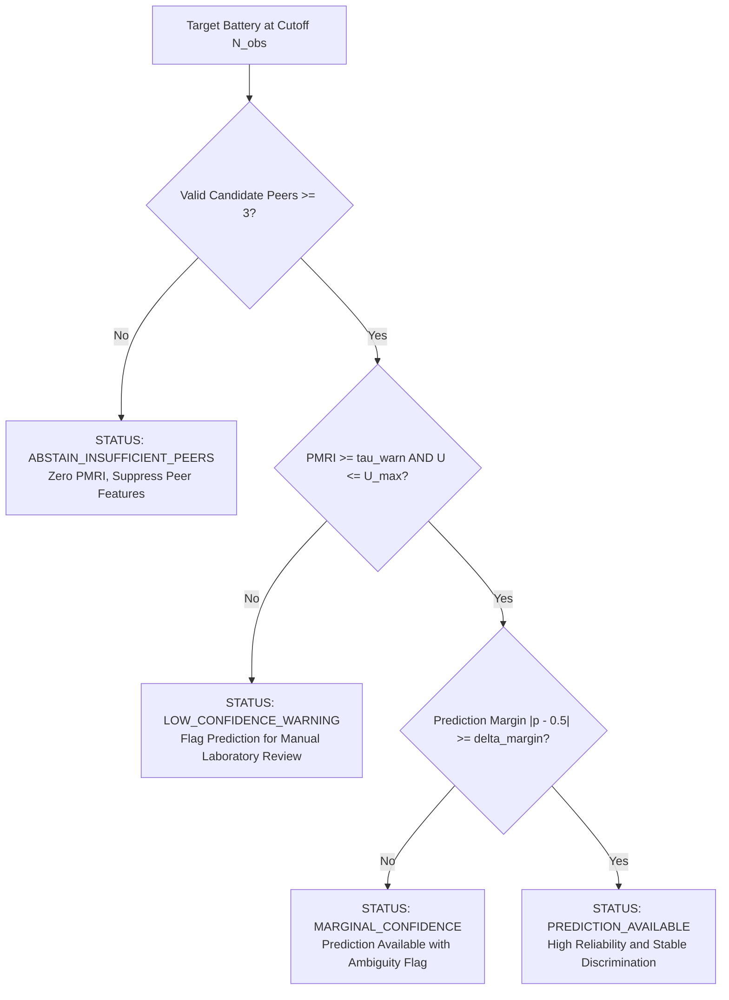

# Confidence-Aware Decision & Abstention Policy

**Project Title:** Confidence-Aware Peer-Relative Degradation Trajectory Analysis for Early End-of-Life Risk Prediction in Lithium-Ion Batteries  
**Document:** Operational Decision Framework, Reliability Tiers, and Abstention Protocol  
**Version:** 1.0 (Phase 6 / Capstone Review 1 Specification)  

---

## 1. Foundational Separation of Scientific Concepts

To preserve academic integrity and avoid conflating distinct statistical quantities, this system strictly maintains four distinct conceptual dimensions:

| Dimension | Variable Symbol | Definition | Permitted Interpretation | Prohibited Interpretation |
| :--- | :---: | :--- | :--- | :--- |
| **EOL Risk Probability** | $\hat{p} \in [0.0, 1.0]$ | Estimated probability that the battery will fail (capacity $\le 80\%$) within 500 cycles post-cutoff. | Likelihood of near-term failure given observable covariates. | **Not** an indicator of reference peer quality or model confidence. |
| **Peer-Match Reliability** | $\text{PMRI} \in [0.0, 1.0]$ | Composite score evaluating geometric proximity, reference agreement, and condition consistency. | Suitability and representativeness of the reference comparison group. | **Not** a failure probability; **not** a calibrated posterior confidence. |
| **Predictive Uncertainty / Instability** | $U \ge 0.0$ | Counterfactual perturbation standard deviation under Leave-One-Out (LOO) peer substitutions. | Sensitivity of the peer prediction to individual reference peer identities. | **Not** aleatoric electrochemical noise. |
| **Decision Status** | Status Enum | Operational recommendation category based on verified decision rules. | Automated screening flag (Accept, Low Confidence, or Abstain). | **Not** a safety-critical BMS shutdown command. |

---

## 2. Four Operational Decision Statuses

Every prediction generated for an eligible cell at observation cutoff $N_{\text{obs}}$ is tagged with an explicit operational status:

### 1. `PREDICTION_AVAILABLE` (Normal Screening)
- **Criteria:** Reference peer group has valid candidates ($k \ge 3$), $\text{PMRI} \ge \tau_{\text{warn}}$, counterfactual instability $U \le U_{\text{max}}$, and predicted probability is decisive ($|\hat{p} - 0.5| \ge \delta_{\text{margin}}$).
- **System Action:** Output predicted failure probability, classification risk tier, and peer-relative trajectory deviations with standard reporting.

### 2. `LOW_CONFIDENCE_WARNING` (Attenuated Reliability)
- **Criteria:** Reference peers exist but mean standardized distance is elevated ($d_{\text{mean}} > 2.5$) or $\text{PMRI} < \tau_{\text{warn}}$ (typically $\text{PMRI} < 0.70$).
- **System Action:** Output prediction alongside an amber warning banner. The user interface explicitly notifies the analyst that the target cell exhibits atypical initial conditions or high peer trajectory dispersion. Blended models (such as M5) automatically attenuate peer-relative feature weights in favor of individual degradation history.

### 3. `HIGH_COUNTERFACTUAL_DISPERSION` (Instability Flag)
- **Criteria:** Counterfactual sensitivity analysis demonstrates that substituting one peer changes the predicted failure probability by $\Delta p > 0.15$ ($U > 0.05$).
- **System Action:** Output an alert indicating that peer-relative predictions are highly sensitive to specific reference cell identities. The system falls back to the individual trajectory model (M2).

### 4. `ABSTAIN_INSUFFICIENT_PEERS` (Hard Abstention)
- **Criteria:** The candidate reference pool contains fewer than $k_{\text{min}} = 3$ eligible reference batteries sharing compatible operating envelopes, or the cell belongs to an excluded test cohort.
- **System Action:** The system strictly suppresses peer-relative trajectory features (`peer_traj` columns set to neutral baselines), sets $\text{PMRI} = 0.0$, and abstains from peer-relative classification, issuing a clear audit message: *"Insufficient reference peers available for peer-relative screening."*

---

## 3. Training-Only Threshold Determination Protocol

To prevent optimistic bias and test-set data leakage:

1. **Threshold Tuning Isolation:** All decision thresholds ($\tau_{\text{warn}}$, optimal classification threshold $\tau_{\text{opt}}$, and coverage percentiles $\tau_c$) are computed strictly on the training partition ($N = 41$ cells) using 5-fold cross-validation out-of-fold predictions.
2. **Youden's J Classification Threshold:** Optimal probability thresholds $\tau_{\text{opt}}$ maximize Youden's $J = \text{Sensitivity} + \text{Specificity} - 1$ on training OOF predictions.
3. **Selective Prediction Coverage:** The abstention threshold $\tau_c$ for target coverage $c \in [0.60, 1.00]$ is the $(1-c)$-th quantile of trust scores on training OOF predictions. No primary test or secondary test labels are ever referenced during threshold selection.

---

## 4. Empirical Validation on Held-Out Test Cohort

Evaluating the selective prediction policy on the independent primary test set ($N = 43$ cells) demonstrates:
- **Error Reduction Under Abstention:** Retaining the top 95% most reliable predictions at Cutoff 100 improves test AUROC from **0.9108 to 0.9372** and accuracy from **92.9% to 95.1%**.
- **Calibration Stratification:** In the primary test partition, batteries with $\text{PMRI} \ge \text{median}$ exhibit a Brier score of **0.039** compared to **0.126** for $\text{PMRI} < \text{median}$ (a **3.2× error reduction**).
- **Conservative Reporting:** Where evidence is ambiguous or reference peers are distant, the system transparently documents the limitation rather than presenting uncalibrated, over-confident risk probabilities.
