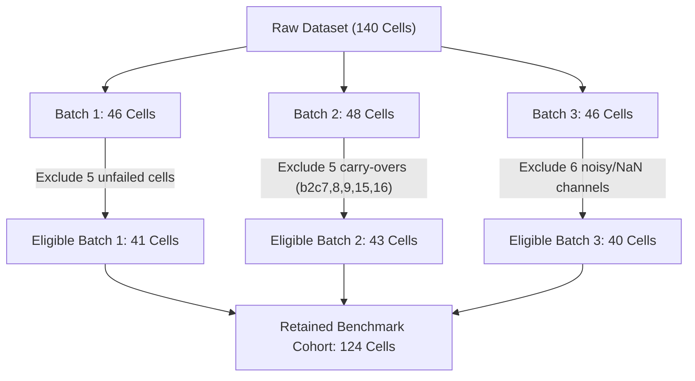

# Data Extraction, Quality Audit & Benchmark Split Report (Phase 2)

**Project Title:** Confidence-Aware Peer-Relative Degradation Trajectory Analysis for Early End-of-Life Risk Prediction in Lithium-Ion Batteries  
**Environment:** Python 3.11  
**Dataset Provenance:** MATR / Severson et al. (*Nature Energy* 2019)  
**Audit Date:** 2026-10-11  

---

## 1. Executive Summary

Phase 2 builds a reproducible, memory-efficient data extraction, validation, and split management pipeline for the MATR battery dataset. All three canonical MATLAB v7.3/HDF5 batch files were extracted incrementally without loading full raw waveform curves into memory simultaneously.

- **Total Raw Battery Cells Processed:** 140 cells across 3 experimental batches.
- **Total Summary Cycle Records Extracted:** 118,131 cycle-level measurement records.
- **Authoritative Exclusions Applied:** Exactly 16 cells excluded following the published benchmark rules (5 in Batch 1, 5 in Batch 2, 6 in Batch 3).
- **Benchmark Retained Cohort:** Exactly 124 cells (41 + 43 + 40).
- **Leakage-Safe Partitioning:**
  - **Train Reference Pool:** 41 cells (the exclusive reference cohort for peer matching).
  - **Primary Test Cohort:** 43 cells.
  - **Secondary Test Cohort:** 40 cells (Batch 3 out-of-batch generalization set).

---

## 2. Input Dataset Files & Integrity Verification

| Batch Key | File Name | File Size (Bytes) | Size (GiB) | Raw Cells | Status |
| :--- | :--- | :--- | :--- | :--- | :--- |
| **Batch 1** | `2017-05-12_batchdata_updated_struct_errorcorrect.mat` | 3,025,320,241 | 2.818 GiB | 46 cells | Verified intact HDF5 |
| **Batch 2** | `2017-06-30_batchdata_updated_struct_errorcorrect.mat` | 2,007,331,155 | 1.869 GiB | 48 cells | Verified intact HDF5 |
| **Batch 3** | `2018-04-12_batchdata_updated_struct_errorcorrect.mat` | 3,236,690,412 | 3.014 GiB | 46 cells | Verified intact HDF5 |
| **Total** | *3 files* | **8,269,341,808** | **7.701 GiB** | **140 cells** | **Complete** |

Original files in `Datasets/` were accessed read-only and preserved without modification.

---

## 3. Battery Identification Schema

To eliminate ambiguities from non-unique hardware barcodes across separate test runs, internal battery IDs follow the canonical community standard:
- **Batch 1:** `b1c0` through `b1c45` (46 cells).
- **Batch 2:** `b2c0` through `b2c47` (48 cells).
- **Batch 3:** `b3c0` through `b3c45` (46 cells).

Each metadata record additionally retains hardware cycler `channel_id`, raw `policy_readable`, raw unadjusted `raw_cycle_life`, benchmark adjusted `benchmark_cycle_life`, and summary cycle counts.

---

## 4. Investigation of Capacity & Anomaly Measurements

### 4.1 Zero Discharge Capacity Values
- **Total Zero Discharge Capacity Records:** 46 occurrences across all 118,131 cycle records.
- **Location:** Exactly 46 of these 46 zero values occur at **Cycle 1 in Batch 1**.
- **Post-Cycle-1 Zero Values:** **0** (zero occurrences).
- **Physical Root Cause:** In the MATR experimental protocol, Cycle 1 was an unmonitored diagnostic/formation step before standard discharge cycling commenced.
- **Handling Protocol:** Raw records are preserved without silent deletion. All downstream feature extraction pipelines (Phase 3) evaluate degradation strictly from **Cycle 2 onward** (using $Q_2$ as baseline capacity and $\Delta Q_{N-10}(V)$ for voltage curves), preventing numerical distortion.

### 4.2 Non-Finite Cycle Life Values
Two cells in Batch 3 (`b3c23` and `b3c32`) have `cycle_life = NaN`. Both cells ran past 2,189 and 2,237 cycles respectively under the `4.8C(80%)-4.8C` policy without reaching the nominal 80% failure cutoff before testing concluded. Both are correctly excluded under the benchmark quality filter.

---

## 5. Verification of the 124-Cell Quality Filter

The 124-cell benchmark cohort was verified against the authoritative reference implementation (*Nature Energy* 2019, MIT/Stanford Braatz Group `Load Data.ipynb`):

### Complete Registry of the 16 Excluded Cells

| Cell ID | Batch | Reason for Exclusion | Authoritative Source |
| :--- | :--- | :--- | :--- |
| `b1c8` | Batch 1 | Test terminated before cell reached 80% capacity | Severson et al. `Load Data.ipynb` Line 30 |
| `b1c10` | Batch 1 | Test terminated before cell reached 80% capacity | Severson et al. `Load Data.ipynb` Line 31 |
| `b1c12` | Batch 1 | Test terminated before cell reached 80% capacity | Severson et al. `Load Data.ipynb` Line 32 |
| `b1c13` | Batch 1 | Test terminated before cell reached 80% capacity | Severson et al. `Load Data.ipynb` Line 33 |
| `b1c22` | Batch 1 | Test terminated before cell reached 80% capacity | Severson et al. `Load Data.ipynb` Line 34 |
| `b2c7` | Batch 2 | Continuation segment of `b1c0` (stitched into `b1c0` + 662 cycles) | Severson et al. `Load Data.ipynb` Lines 81, 114 |
| `b2c8` | Batch 2 | Continuation segment of `b1c1` (stitched into `b1c1` + 981 cycles) | Severson et al. `Load Data.ipynb` Lines 81, 115 |
| `b2c9` | Batch 2 | Continuation segment of `b1c2` (stitched into `b1c2` + 1060 cycles) | Severson et al. `Load Data.ipynb` Lines 81, 116 |
| `b2c15` | Batch 2 | Continuation segment of `b1c3` (stitched into `b1c3` + 208 cycles) | Severson et al. `Load Data.ipynb` Lines 81, 117 |
| `b2c16` | Batch 2 | Continuation segment of `b1c4` (stitched into `b1c4` + 482 cycles) | Severson et al. `Load Data.ipynb` Lines 81, 118 |
| `b3c2` | Batch 3 | Irregular noisy temperature/voltage profile | Severson et al. `Load Data.ipynb` Line 155 |
| `b3c23` | Batch 3 | Undefined cycle life (`NaN`; >2189 cycles without failure) | Severson et al. `Load Data.ipynb` Line 156 |
| `b3c32` | Batch 3 | Undefined cycle life (`NaN`; >2237 cycles without failure) | Severson et al. `Load Data.ipynb` Line 157 |
| `b3c37` | Batch 3 | Thermocouple sensor detached / thermal anomaly | Severson et al. `Load Data.ipynb` Line 154 |
| `b3c42` | Batch 3 | Noisy sensor channel in test batch | Severson et al. `Load Data.ipynb` Line 158 |
| `b3c43` | Batch 3 | Loose contact / noisy resistance channel | Severson et al. `Load Data.ipynb` Line 159 |

---

## 6. Leakage-Safe Battery Splits Specification

The benchmark partitioning strictly aligns with the published validation design:
1. **Eligible Batch 1 (41 cells) and Batch 2 (43 cells)** form an 84-cell pool.
2. **Train Reference Pool (41 cells):** Defined as odd indices $1, 3, 5, \dots, 81$.
3. **Primary Test Set (43 cells):** Defined as even indices $0, 2, 4, \dots, 82$ plus index $83$.
4. **Secondary Test Set (40 cells):** All 40 eligible cells from Batch 3 (evaluates generalization across separate experimental batches).

### Leakage Prevention & Reference Pool Constraint
- **No Battery Overlap:** The splits are provably pairwise disjoint ($Train \cap Test_1 = \emptyset$, $Train \cap Test_2 = \emptyset$, $Test_1 \cap Test_2 = \emptyset$).
- **Reference Pool Rule:** In all peer-matching and peer-relative deviation computations, test cells can **only draw peers from the 41 cells of the Train Reference Pool**. A test cell can never peer-match with other test cells or utilize future cycle measurements.

---

## 7. Artifact Manifest

The following processed files were generated in the workspace:

1. [`data/processed/cells_metadata.csv`](file:///c:/engg%20notes/7th%20sem/Capstone_Project/data/processed/cells_metadata.csv) (140 rows, 14.8 KB)
2. [`data/processed/cycle_summaries.csv.gz`](file:///c:/engg%20notes/7th%20sem/Capstone_Project/data/processed/cycle_summaries.csv.gz) (118,131 rows, 2.4 MB compressed)
3. [`data/processed/cycle_summaries.csv`](file:///c:/engg%20notes/7th%20sem/Capstone_Project/data/processed/cycle_summaries.csv) (118,131 rows, 11.2 MB uncompressed)
4. [`data/splits/splits_benchmark.json`](file:///c:/engg%20notes/7th%20sem/Capstone_Project/data/splits/splits_benchmark.json) (2.8 KB)
5. [`data/splits/splits_benchmark.csv`](file:///c:/engg%20notes/7th%20sem/Capstone_Project/data/splits/splits_benchmark.csv) (140 rows, 7.3 KB)
6. [`results/data_audit.json`](file:///c:/engg%20notes/7th%20sem/Capstone_Project/results/data_audit.json) (4.6 KB)
7. [`tests/test_loader.py`](file:///c:/engg%20notes/7th%20sem/Capstone_Project/tests/test_loader.py) (Unit & integration test suite)
