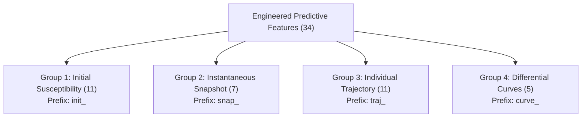

# Feature Dictionary & Specification (Phase 3)

**Project Title:** Confidence-Aware Peer-Relative Degradation Trajectory Analysis for Early End-of-Life Risk Prediction in Lithium-Ion Batteries  
**Degree:** B.Tech Computer Science & Engineering (Capstone Project)  
**Document:** Feature Taxonomy, Mathematical Formulations, and Physical Units  

---

## 1. Overview & Data Convention

All features are calculated strictly using measurements available up to the observation cutoff $N_{\text{obs}} \in \{40, 70, 100\}$ cycles.

### Important Data Initialization Convention
- **Cycle 1 Diagnostic Artifact:** In the MATR/Severson dataset, Cycle 1 was an unmonitored diagnostic/formation cycle where discharge capacity is unrecorded ($0.0$ Ah).
- **Physical Baseline Standard:** To prevent mathematical corruption from this initialization zero, all initial-condition metrics and trajectory deltas use **Cycle 2** as the physical baseline ($Q_2, IR_2, T_2$).

---

## 2. Feature Groups & Taxonomy

The 34 engineered features are divided into four orthogonal functional groups:

---

### Group 1: Initial-Condition Features (`init_`, 11 features)
Represents the battery's manufacturing variability and initial state prior to significant operational aging (evaluated at Cycle 2).

| Feature Name | Formulation / Source | Units | Window | Description |
| :--- | :--- | :--- | :--- | :--- |
| `init_q_discharge` | $Q_2$ | Ah | Cycle 2 | Baseline discharge capacity |
| `init_q_charge` | $Q_{\text{charge}, 2}$ | Ah | Cycle 2 | Baseline charge capacity |
| `init_coulombic_eff` | $Q_2 / Q_{\text{charge}, 2}$ | Fraction | Cycle 2 | Baseline coulombic efficiency |
| `init_internal_resistance` | $IR_2$ | $\Omega$ | Cycle 2 | Baseline internal resistance |
| `init_temp_max` | $T_{\text{max}, 2}$ | °C | Cycle 2 | Baseline peak temperature during cycling |
| `init_temp_avg` | $T_{\text{avg}, 2}$ | °C | Cycle 2 | Baseline mean cycle temperature |
| `init_temp_min` | $T_{\text{min}, 2}$ | °C | Cycle 2 | Baseline minimum cycle temperature |
| `init_charge_time` | $t_{\text{charge}, 2}$ | Minutes | Cycle 2 | Baseline charging duration |
| `init_policy_c1` | First fast-charge C-rate | C-rate (1/h) | Static | Nominal initial charging speed |
| `init_policy_soc` | SOC transition point | % | Static | State of charge where step-down occurs |
| `init_policy_c2` | Second-stage C-rate | C-rate (1/h) | Static | Nominal secondary charging speed |

---

### Group 2: Instantaneous Snapshot Features (`snap_`, 7 features)
Represents the battery's current state of health at the exact observation cutoff $N_{\text{obs}}$.

| Feature Name | Formulation / Source | Units | Window | Description |
| :--- | :--- | :--- | :--- | :--- |
| `snap_q_discharge` | $Q_{N_{\text{obs}}}$ | Ah | Cycle $N_{\text{obs}}$ | Current discharge capacity at cutoff |
| `snap_q_charge` | $Q_{\text{charge}, N_{\text{obs}}}$ | Ah | Cycle $N_{\text{obs}}$ | Current charge capacity at cutoff |
| `snap_coulombic_eff` | $Q_{N_{\text{obs}}} / Q_{\text{charge}, N_{\text{obs}}}$ | Fraction | Cycle $N_{\text{obs}}$ | Current coulombic efficiency |
| `snap_internal_resistance` | $IR_{N_{\text{obs}}}$ | $\Omega$ | Cycle $N_{\text{obs}}$ | Current internal resistance at cutoff |
| `snap_temp_max` | $T_{\text{max}, N_{\text{obs}}}$ | °C | Cycle $N_{\text{obs}}$ | Current peak temperature at cutoff |
| `snap_temp_avg` | $T_{\text{avg}, N_{\text{obs}}}$ | °C | Cycle $N_{\text{obs}}$ | Current mean temperature at cutoff |
| `snap_charge_time` | $t_{\text{charge}, N_{\text{obs}}}$ | Minutes | Cycle $N_{\text{obs}}$ | Current charging duration at cutoff |

---

### Group 3: Emerging Individual-Trajectory Features (`traj_`, 11 features)
Quantifies dynamic aging rates and trajectory curvature over cycles $n \in [2, N_{\text{obs}}]$.

| Feature Name | Formulation / Source | Units | Window | Description |
| :--- | :--- | :--- | :--- | :--- |
| `traj_q_fade` | $Q_{N_{\text{obs}}} - Q_2$ | Ah | $[2, N_{\text{obs}}]$ | Net capacity loss over observed window |
| `traj_q_retention` | $Q_{N_{\text{obs}}} / Q_2$ | Fraction | $[2, N_{\text{obs}}]$ | Fraction of initial capacity retained |
| `traj_q_slope` | $\frac{dQ}{dn} = \text{polyfit}_1(n, Q(n))$ | Ah/cycle | $[2, N_{\text{obs}}]$ | Linear degradation rate of discharge capacity |
| `traj_q_curvature` | $\frac{d^2Q}{dn^2} = \text{polyfit}_2(n, Q(n))[0]$ | Ah/cycle$^2$ | $[2, N_{\text{obs}}]$ | Second-order degradation acceleration |
| `traj_q_std` | $\sqrt{\frac{1}{K}\sum (Q(n) - \bar{Q})^2}$ | Ah | $[2, N_{\text{obs}}]$ | Trajectory dispersion / volatility |
| `traj_q_min` | $\min_{n \in [2, N_{\text{obs}}]} Q(n)$ | Ah | $[2, N_{\text{obs}}]$ | Minimum observed capacity |
| `traj_ir_change` | $IR_{N_{\text{obs}}} - IR_2$ | $\Omega$ | $[2, N_{\text{obs}}]$ | Internal resistance growth |
| `traj_ir_slope` | $\frac{d(IR)}{dn} = \text{polyfit}_1(n, IR(n))$ | $\Omega$/cycle | $[2, N_{\text{obs}}]$ | Linear growth rate of internal resistance |
| `traj_temp_max_change`| $T_{\text{max}, N_{\text{obs}}} - T_{\text{max}, 2}$ | °C | $[2, N_{\text{obs}}]$ | Net thermal rise drift |
| `traj_temp_avg_mean` | $\frac{1}{K} \sum T_{\text{avg}}(n)$ | °C | $[2, N_{\text{obs}}]$ | Long-term average operating temperature |
| `traj_charge_time_change` | $t_{\text{charge}, N_{\text{obs}}} - t_{\text{charge}, 2}$ | Minutes | $[2, N_{\text{obs}}]$ | Drift in charging duration |

---

### Group 4: Differential Discharge Curve Features (`curve_`, 5 features)
Computed from linearly interpolated discharge capacity curves $Q_n(V)$ evaluated on the standardized 1,000-point discharge voltage grid $V \in [3.5\text{V}, 2.0\text{V}]$:
$$\Delta Q_{N_{\text{obs}}-10}(V) = Q_{N_{\text{obs}}}(V) - Q_{10}(V)$$

| Feature Name | Formulation | Units | Window | Description |
| :--- | :--- | :--- | :--- | :--- |
| `curve_delta_q_var_log10` | $\log_{10}(\text{Var}(\Delta Q(V)))$ | $\log_{10}(\text{Ah}^2)$ | $[10, N_{\text{obs}}]$ | Canonical Severson et al. log-variance feature |
| `curve_delta_q_min` | $\min_V(\Delta Q(V))$ | Ah | $[10, N_{\text{obs}}]$ | Minimum differential discharge capacity |
| `curve_delta_q_mean` | $\text{mean}_V(\Delta Q(V))$ | Ah | $[10, N_{\text{obs}}]$ | Mean differential discharge capacity shift |
| `curve_delta_q_skew` | Fisher-Pearson $\text{Skew}(\Delta Q(V))$ | Dimensionless | $[10, N_{\text{obs}}]$ | Asymmetry of differential voltage curve shift |
| `curve_delta_q_kurtosis` | Fisher-Pearson $\text{Kurtosis}(\Delta Q(V))$ | Dimensionless | $[10, N_{\text{obs}}]$ | Tail peakedness of differential voltage curve shift |

---

## 3. Metadata & Identification Schema

| Column Name | Type | Description |
| :--- | :--- | :--- |
| `cell_id` | string | Stable global battery identifier (e.g. `b1c0`..`b3c45`) |
| `batch` | string | Experimental batch origin (`batch1`, `batch2`, `batch3`) |
| `cutoff` | integer | Observation window cutoff cycle ($40, 70, 100$) |
| `channel_id` | integer | Physical Arbin cycler channel index |
| `policy` | string | Full fast-charging protocol label |
| `is_benchmark_eligible` | boolean | True if cell is retained in benchmark 124 cohort |
| `benchmark_partition` | string | Split assignment (`train`, `primary_test`, `secondary_test`, `excluded`) |
| `exclusion_reason` | string | Authoritative documentation of filtering reason |

---

## 4. Target Variables Schema

| Column Name | Type | Target Scope | Description |
| :--- | :--- | :--- | :--- |
| `target_eol_cycle` | float | Continuous | Observed cycle count to 80% nominal capacity |
| `target_rul` | float | Continuous | Remaining useful life: $\text{EOL} - N_{\text{obs}}$ |
| `target_fail_within_300` | float (0/1/NaN) | Binary ($H=300$) | Failure occurs within $N_{\text{obs}} + 300$ cycles |
| `status_fail_within_300` | string | Audit | Status: `'positive'`, `'negative'`, `'censored'` |
| `target_fail_within_500` | float (0/1/NaN) | Binary ($H=500$, Primary) | Failure occurs within $N_{\text{obs}} + 500$ cycles |
| `status_fail_within_500` | string | Audit | Status: `'positive'`, `'negative'`, `'censored'` |
| `target_fail_by_700` | float (0/1/NaN) | Binary ($\text{EOL} \le 700$) | Early failure occurring by cycle 700 |
| `status_fail_by_700` | string | Audit | Status: `'positive'`, `'negative'`, `'censored'` |
