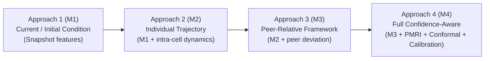
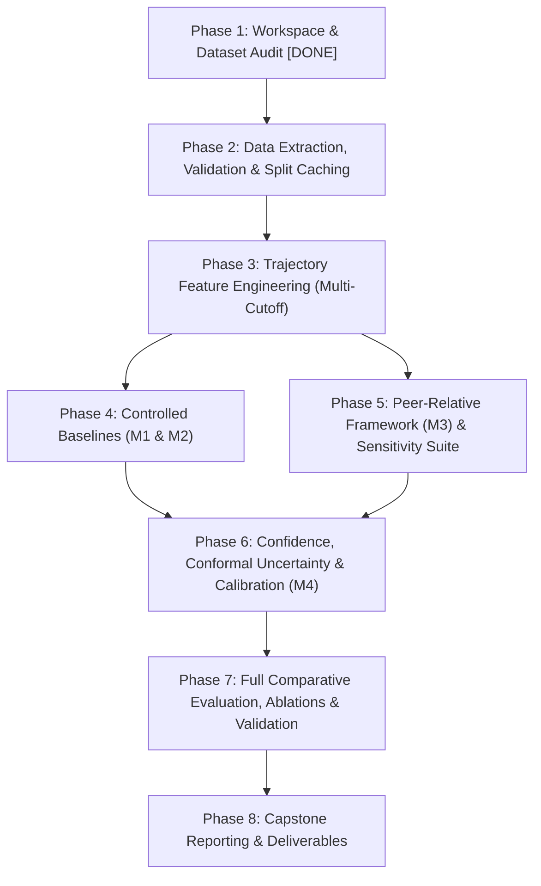

# Implementation Roadmap

**Project Title:** Confidence-Aware Peer-Relative Degradation Trajectory Analysis for Early End-of-Life Risk Prediction in Lithium-Ion Batteries  
**Degree:** B.Tech Computer Science & Engineering (Capstone Project)  
**Target Environment:** Python 3.11  

---

## 1. Research Gap & Core Problem Formulation

### Central Research Question
> **Does a battery's deviation from the degradation trajectories of appropriately matched peer batteries provide reliable incremental predictive information about future end-of-life (EOL) risk beyond its initial/current health condition and individual degradation history?**

### Scientific Principles & Ground Rules
1. **Hypothesis-Driven Objectivity:** Do not presume that the peer-relative or confidence-aware framework is superior prior to rigorous empirical validation. If peer-relative deviation fails to provide statistically significant gains over individual baselines (e.g., due to cohort variance or small peer pools), report this finding transparently.
2. **Tripartite Conceptual Distinction:** Keep the following three outputs mathematically and conceptually distinct:
   - **EOL Risk Probability ($\hat{p} \in [0, 1]$):** Calibrated likelihood that the cell reaches EOL before a specified cycle horizon.
   - **Peer-Match Reliability Index ($\text{PMRI} \in [0, 1]$):** Metric of peer neighborhood density and operational similarity in the reference pool (covariate support indicator).
   - **Prediction Uncertainty ($U \ge 0$):** Predictive dispersion (e.g., conformal prediction interval width $\hat{y}_{\text{upper}} - \hat{y}_{\text{lower}}$ at coverage $1-\alpha$, or predictive entropy).
3. **Strict Battery-Level Holdout & Leakage Prevention:**
   - No data from the same physical battery cell may appear in both training and test partitions.
   - **Reference Pool Constraint:** Test cells must be matched against peer cohorts drawn **exclusively from the training reference library**. A test cell can never peer-match against other test cells or future cycle data.
   - All feature scalers, normalizations, and calibration maps must be fit strictly on training/calibration sets.

---

## 2. Experimental Design Matrix

### 2.1 The Four Controlled Experimental Approaches
To isolate the marginal value of each information source, all experiments will compare four controlled models under identical evaluation splits:

| Approach | Model Identifier | Feature Set & Mechanisms |
| :--- | :--- | :--- |
| **Approach 1** | `M1_CurrentCondition` | Initial susceptibility ($Q_2, IR_2, T_2$) + Instantaneous condition snapshot at cutoff $N_{\text{obs}}$ ($Q_{N_{\text{obs}}}, IR_{N_{\text{obs}}}, T_{N_{\text{obs}}}$, charging policy). |
| **Approach 2** | `M2_IndividualTrajectory` | Approach 1 features + isolated cell historical dynamics ($dQ/dn$ slope, $\Delta Q_{N_{\text{obs}}-10}(V)$ curve statistics, $\Delta IR$, temperature rise). *Replicates Severson et al. benchmark.* |
| **Approach 3** | `M3_PeerRelative` | Approach 2 features + peer-relative trajectory deviations (trajectory $Z$-score, slope divergence relative to peer cohort, DTW distance to peer median curve). |
| **Approach 4** | `M4_ConfidenceAware` | Approach 3 features + Peer-Match Reliability Index (PMRI) gating/weighting + Split Conformal Prediction intervals + Calibrated risk probabilities. |

### 2.2 Feature Disentanglement: Initial Susceptibility vs. Emerging Degradation
Where supported by the MATR/Severson dataset, features are explicitly categorized into:
- **Initial Battery Susceptibility (Cycles 1–2):** Manufacturing variability and intrinsic baseline properties before major wear:
  - Baseline discharge capacity $Q_2$.
  - Baseline internal resistance $IR_2$.
  - Early thermal response: $T_{\text{max}, 2}$, $T_{\text{avg}, 2}$.
  - Nominal fast-charging protocol (C-rate 1, SOC switch point, C-rate 2).
- **Emerging Degradation Dynamics (Cycles $2 \to N_{\text{obs}}$):** Dynamic wear and kinetic degradation:
  - Capacity loss slope $dQ/dn$ and acceleration over cycles $10 \to N_{\text{obs}}$.
  - Differential discharge curve shift: $\Delta Q_{N_{\text{obs}}-10}(V)$ summary statistics (variance, minimum, mean, skew, kurtosis).
  - Internal resistance growth $\Delta IR = IR_{N_{\text{obs}}} - IR_{10}$.
  - Thermal rise drift $\Delta T_{\text{max}} = T_{\text{max}, N_{\text{obs}}} - T_{\text{max}, 10}$.

### 2.3 Observation Cutoffs & Prediction Horizons
- **Early-Life Observation Cutoffs ($N_{\text{obs}}$):**
  - $N_{\text{obs}} = 40$ cycles (ultra-early screening).
  - $N_{\text{obs}} = 70$ cycles (mid-early transition).
  - $N_{\text{obs}} = 100$ cycles (standard benchmark cutoff).
- **Predefined Future Prediction Horizons ($H$):**
  - *Continuous EOL Target:* Total cycles to $80\%$ nominal capacity ($y = \text{cycle\_life}$).
  - *Remaining Useful Life Target:* $\text{RUL}_{N_{\text{obs}}} = y - N_{\text{obs}}$.
  - *Horizon-Specific Binary EOL Risk:*
    - Horizon 1 (Short-term): Failure within next 300 cycles ($\text{EOL} \le N_{\text{obs}} + 300$).
    - Horizon 2 (Medium-term): Failure within next 500 cycles ($\text{EOL} \le N_{\text{obs}} + 500$).
    - Horizon 3 (Absolute Early Failure): Premature retirement in the lower quartile ($\text{EOL} \le 700$ cycles).

### 2.4 Peer Matching Exploration & Sensitivity
- **Similarity Distance Metrics:** Exact policy matching vs. Euclidean distance in normalized initial susceptibility space vs. Mahalanobis distance vs. Dynamic Time Warping (DTW) on early capacity fade.
- **Peer-Group Size Sensitivity ($k$):** Evaluate $k \in \{3, 5, 8, 12, \text{all policy peers}\}$.
- **Peer Trajectory Agreement / Cohort Consensus:** Quantify intra-peer trajectory variance $\sigma^2_{\text{cohort}}(n)$ to determine whether peer dispersion degrades or enhances prediction confidence.

### 2.5 Systematic Ablation Experiments
- Full Approach 4 (`M4`).
- Ablation A: Remove Peer-Match Reliability Index (PMRI) weighting.
- Ablation B: Remove peer-relative deviation features (reducing to Approach 2).
- Ablation C: Remove cohort consensus weighting.
- Ablation D (Negative Control): Random pseudo-peer matching (matches cells with randomly assigned training peers to verify that observed improvements stem from genuine physical peer alignment rather than arbitrary regularization).

---

## 3. Evaluation Metrics Suite

1. **Continuous Prediction Accuracy (Regression):**
   - Root Mean Squared Error (RMSE).
   - Mean Absolute Percentage Error (MAPE).
   - Coefficient of Determination ($R^2$).
2. **Binary Early Abnormal Screening (Classification):**
   - Area Under ROC Curve (AUROC).
   - Area Under Precision-Recall Curve (AUPRC).
   - False Alarm Rate (False Positive Rate at target $90\%$ sensitivity).
   - Early-Warning Lead Time: Average cycles between $N_{\text{obs}}$ and true failure for detected at-risk batteries ($L = y - N_{\text{obs}}$).
3. **Probability Calibration:**
   - Expected Calibration Error (ECE) across 10 confidence bins.
   - Brier Score: $\frac{1}{N} \sum_{i=1}^N (\hat{p}_i - y_i)^2$.
   - Visual Reliability Diagrams (observed frequency vs. forecast probability).
4. **Uncertainty Quantification:**
   - Empirical coverage rate at nominal $90\%$ confidence level ($1 - \alpha = 0.90$).
   - Mean Prediction Interval Width (MPIW / Sharpness).

---

## 4. Phase-by-Phase Implementation Plan

---

### Phase 1: Workspace & Dataset Audit (Completed)
- [x] Inspect workspace and verify the 3 MATR/Severson `.mat` batch files (~8.27 GB, 140 raw cells).
- [x] Verify Python 3.11.9 environment and installed dependencies.
- [x] Create project documentation (`README.md`, `docs/roadmap.md`, `requirements.txt`).
- [x] Integrate updated research gap, experimental design matrix, and 10 research requirements.

---

### Phase 2: Data Extraction, Validation & Benchmark Split Caching (Completed)
- [x] Implement robust HDF5 extractor in `src/data/loader.py`:
  - Memory-efficient streaming extraction of cycle summary records (`QDischarge`, `IR`, `Tmax`, `Tavg`, `chargetime`, `cycle`).
  - Carried-over continuation cycles stitched onto resumed cells (`b1c0`..`b1c4`).
- [x] Encode benchmark quality filtering:
  - Authoritative 16-channel exclusions verified and implemented (`EXCLUSION_REGISTRY`), retaining exactly 124 benchmark cells.
- [x] Implement leak-free partition splits:
  - **Train Cohort:** 41 cells — serving as the **exclusive reference pool** for peer matching.
  - **Primary Test Cohort:** 43 cells.
  - **Secondary Test Cohort:** 40 cells (Batch 3 out-of-batch generalization set).
- [x] Cache extracted tabular data in `data/processed/` (`cells_metadata.csv`, `cycle_summaries.csv.gz`) and split indices in `data/splits/`.
- [x] Compile data quality audit report: [`docs/data_audit_report.md`](data_audit_report.md) and [`results/data_audit.json`](../results/data_audit.json).
- [x] Complete unit and integration test suite: [`tests/test_loader.py`](../tests/test_loader.py).

---

### Phase 3: Data Preparation, Feature Engineering & Prediction-Target Definition (Completed)
- [x] Implement feature extraction modules in `src/features/` (`feature_engineering.py`, `target_builder.py`, `modeling_dataset.py`):
  - **Initial Susceptibility (`init_`):** $Q_2, Q_{\text{charge}, 2}, \text{CE}_2, IR_2, T_{\text{max}, 2}, T_{\text{avg}, 2}, T_{\text{min}, 2}, t_{\text{charge}, 2}$, and fast-charging parameters ($C_1, \text{SOC}\%, C_2$).
  - **Instantaneous Snapshot (`snap_`):** $Q_{N_{\text{obs}}}, Q_{\text{charge}, N_{\text{obs}}}, \text{CE}_{N_{\text{obs}}}, IR_{N_{\text{obs}}}, T_{\text{max}, N_{\text{obs}}}, T_{\text{avg}, N_{\text{obs}}}, t_{\text{charge}, N_{\text{obs}}}$.
  - **Emerging Individual Trajectory (`traj_`):** Capacity loss $\Delta Q$, retention, $dQ/dn$ slope, $d^2Q/dn^2$ curvature, capacity standard deviation, minimum capacity, $\Delta IR$, $d(IR)/dn$ slope, $\Delta T_{\text{max}}$, $\bar{T}_{\text{avg}}$, $\Delta t_{\text{charge}}$.
  - **Differential Curves (`curve_`):** $\Delta Q_{N_{\text{obs}}-10}(V)$ summary statistics ($\log_{10}(\text{Var})$, $\min$, $\text{mean}$, skew, kurtosis) on the 1,000-point voltage grid.
- [x] Implement prediction target definitions with strict censoring rules (`TargetBuilder`):
  - Continuous targets: Total Cycle Life ($y$) and Remaining Useful Life ($\text{RUL}_{N_{\text{obs}}}$).
  - Primary binary target: Relative failure within 500 future cycles ($H = 500$, $33.9\% - 37.1\%$ positive).
  - Secondary binary targets: Short-term failure ($H = 300$, $2.4\%$ positive; documented severe class imbalance) and Absolute early failure ($\text{EOL} \le 700$, $43.5\%$ positive).
- [x] Assemble and export master modeling dataset in `data/processed/modeling_dataset.csv` and `.csv.gz` (420 rows, 50 columns; zero null values in eligible cohort).
- [x] Compile detailed documentation: [`docs/target_definition.md`](target_definition.md) and [`docs/feature_dictionary.md`](feature_dictionary.md).
- [x] Compile validation report: [`results/phase3_validation_report.md`](../results/phase3_validation_report.md).
- [x] Implement comprehensive automated test suites: [`tests/test_targets.py`](../tests/test_targets.py), [`tests/test_features.py`](../tests/test_features.py), [`tests/test_no_leakage.py`](../tests/test_no_leakage.py) (18/18 tests passing).

---

### Phase 4: Baseline Models Implementation (M1 & M2)
- [ ] **Approach 1 (Current/Initial Condition - `M1`):**
  - Implement regression for continuous EOL and classification for horizons $H \in \{300, 500, \text{early quartile}\}$.
  - Features: Initial susceptibility + cycle $N_{\text{obs}}$ snapshot.
- [ ] **Approach 2 (Individual Trajectory - `M2`):**
  - Features: Approach 1 + emerging degradation dynamics ($dQ/dn$, $\Delta Q(V)$ stats).
  - Benchmark against Severson et al. published performance.
- [ ] Evaluate across all observation cutoffs $N_{\text{obs}} \in \{40, 70, 100\}$.

---

### Phase 5: Peer-Relative Framework (M3) & Sensitivity Investigation
- [ ] **Peer Matching Engine (`src/peer_relative/matcher.py`):**
  - Form reference peer pool strictly from training data.
  - Support matching strategies: Policy-identical, Euclidean, Mahalanobis, and DTW.
  - Sensitivity investigation across peer group sizes $k \in \{3, 5, 8, 12, \text{all}\}$.
- [ ] **Peer-Relative Feature Extractor (`src/peer_relative/deviations.py`):**
  - Relative trajectory $Z$-score: $Z_{\text{rel}}(n) = \frac{Q_i(n) - \mu_{\text{peer}}(n)}{\sigma_{\text{peer}}(n)}$ for $n \in [10, N_{\text{obs}}]$.
  - Trajectory slope deviation: $\Delta (dQ/dn) = (dQ/dn)_i - \text{median}(\{dQ/dn\}_{\text{peer}})$.
  - Dynamic Time Warping (DTW) distance to peer cohort median trajectory.
  - Peer trajectory agreement / consensus metric: cohort variance $\sigma^2_{\text{cohort}}$.
- [ ] **Model Implementation (`M3_PeerRelative`):**
  - Train regression and classification models using combined individual and peer-relative features.

---

### Phase 6: Confidence, Uncertainty & Calibration (M4)
- [ ] **Peer-Match Reliability Index (PMRI):**
  - Formulate density-based reliability score measuring distance to reference training peers.
  - Evaluate PMRI as a gating weight or confidence filter.
- [ ] **Uncertainty Quantification:**
  - Implement Split Conformal Prediction for distribution-free continuous EOL prediction intervals at $90\%$ nominal coverage.
  - Quantify interval width (sharpness) and empirical coverage.
- [ ] **Probability Calibration:**
  - Fit Platt scaling and Isotonic regression on training calibration folds.
  - Compute Expected Calibration Error (ECE) and generate Reliability Diagrams for binary EOL risk horizons.

---

### Phase 7: Full Comparative Evaluation & Ablations
- [ ] Execute comprehensive comparison across all 4 Approaches (`M1`, `M2`, `M3`, `M4`) across cutoffs $N_{\text{obs}} \in \{40, 70, 100\}$ and horizons $H \in \{300, 500, \text{early quartile}\}$.
- [ ] Evaluate primary test cohort and secondary test cohort (Batch 3) separately.
- [ ] Run full ablation suite (remove PMRI, remove peer features, remove consensus, random pseudo-peers).
- [ ] Compute false-alarm rates (FPR at $90\%$ sensitivity) and early-warning lead times ($L$).
- [ ] Formally test statistical significance of incremental gains (e.g., paired Wilcoxon signed-rank test).
- [ ] Document all results objectively, including scenarios where peer matching does not improve predictions.

---

### Phase 8: Capstone Reporting & Deliverables
- [ ] Consolidate clean, modular code with unit tests.
- [ ] Export publication-quality visualization figures (reliability diagrams, trajectory divergence plots, conformal interval charts, lead-time curves).
- [ ] Compile comprehensive B.Tech Capstone Final Report and presentation slides.
