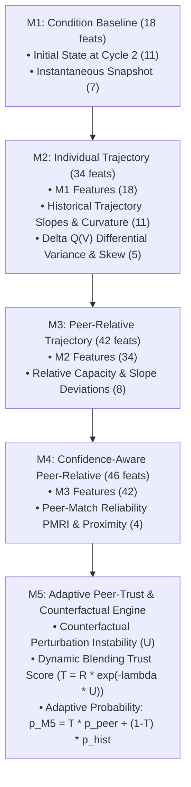

# Model Architecture Specification

**Project Title:** Confidence-Aware Peer-Relative Degradation Trajectory Analysis for Early End-of-Life Risk Prediction in Lithium-Ion Batteries  
**Document:** Mathematical Model Hierarchy, Multi-Algorithm Pipeline Interfaces, and Nested Feature Formulations  
**Execution Date:** 2026-10-22  

---

## 1. Nested Feature Configurations (M1 through M5)

The research methodology establishes a systematically nested feature hierarchy designed to isolate the marginal predictive contribution of each degradation signal:

### Formal Feature Counts
- **M1 (18 features):** `init_q_discharge`, `init_q_charge`, `init_coulombic_eff`, `init_internal_resistance`, `init_temp_max`, `init_temp_avg`, `init_temp_min`, `init_charge_time`, `init_policy_c1`, `init_policy_soc`, `init_policy_c2`, `snap_q_discharge`, `snap_q_charge`, `snap_coulombic_eff`, `snap_internal_resistance`, `snap_temp_max`, `snap_temp_avg`, `snap_charge_time`.
- **M2 (34 features):** M1 (18) + `traj_q_fade`, `traj_q_retention`, `traj_q_slope`, `traj_q_curvature`, `traj_q_std`, `traj_q_min`, `traj_ir_change`, `traj_ir_slope`, `traj_temp_max_change`, `traj_temp_avg_mean`, `traj_charge_time_change`, `curve_delta_q_var_log10`, `curve_delta_q_min`, `curve_delta_q_mean`, `curve_delta_q_skew`, `curve_delta_q_kurtosis`.
- **M3 (42 features):** M2 (34) + `relative_capacity_deviation`, `relative_slope_deviation`, `relative_capacity_ratio`, `relative_fade_deviation`, `relative_ir_deviation`, `peer_trajectory_dispersion`, `peer_slope_dispersion`, `relative_z_score_capacity`.
- **M4 (46 features):** M3 (42) + `pmri`, `peer_similarity_score`, `peer_agreement_score`, `mean_peer_distance`.

---

## 2. Multi-Algorithm Machine Learning Pipelines

To evaluate algorithm generality beyond linear classifiers, four algorithm families are implemented using a unified, standardized interface (`src/models/model_factory.py`):

1. **Standardized Logistic Regression (Linear Baseline):**
   - Pipeline: `StandardScaler() -> LogisticRegression(C=1.0, solver='lbfgs', max_iter=1000, class_weight='balanced')`
   - Properties: Transparent, convex optimization, well-behaved linear weights.
2. **Random Forest Classifier (Bagging Ensemble):**
   - Pipeline: `StandardScaler() -> RandomForestClassifier(n_estimators=100, max_depth=5, min_samples_split=4, class_weight='balanced', random_state=42)`
   - Properties: Non-linear decision surfaces, robust to monotonic feature transformations.
3. **RBF Support Vector Machine (Kernel Method):**
   - Pipeline: `StandardScaler() -> SVC(C=1.0, kernel='rbf', gamma='scale', probability=True, class_weight='balanced', random_state=42)`
   - Properties: Infinite-dimensional feature mapping with Platt scaling probability calibration.
4. **Histogram Gradient Boosting (Boosting Ensemble):**
   - Pipeline: `StandardScaler() -> HistGradientBoostingClassifier(max_iter=100, max_depth=3, learning_rate=0.05, class_weight='balanced', random_state=42)`
   - Properties: Gradient boosting on binned feature histograms, fast training.

---

## 3. M5 Adaptive Peer-Trust Engine Formulation

The M5 model addresses the core scientific limitation of fixed-weight peer integration: when reference peers are unstable or unrepresentative, peer features should not dictate the final prediction.

### Mathematical Dynamics
1. **Counterfactual Perturbation Instability ($U$):**
   Under Leave-One-Out (LOO) peer substitutions $\{P_{-j}\}_{j=1}^k$ where each peer is iteratively replaced by the $(k+1)$-th candidate, the model measures prediction dispersion:
   $$U = \sqrt{\frac{1}{k} \sum_{j=1}^k (\hat{p}_{-j} - \bar{p})^2}$$
2. **Adaptive Trust Score ($T$):**
   Blends PMRI reliability $R$ with an exponential penalty for peer instability:
   $$T = R \cdot \exp(-\lambda U), \quad \lambda \ge 0$$
   Where $\lambda$ is tuned strictly on the training partition ($N=41$) to minimize cross-validation Brier score loss.
3. **Dynamic Model Blending:**
   $$\hat{p}_{\text{M5}} = T \cdot \hat{p}_{\text{peer}} + (1 - T) \cdot \hat{p}_{\text{hist}}$$
   Where $\hat{p}_{\text{peer}} = \hat{p}_{\text{M4}}$ and $\hat{p}_{\text{hist}} = \hat{p}_{\text{M2}}$. When reference peers are unstable ($U > 0.05$) or distant ($R \to 0$), $T \to 0$ and the model smoothly falls back to individual degradation trajectory history ($\hat{p}_{\text{M2}}$).
