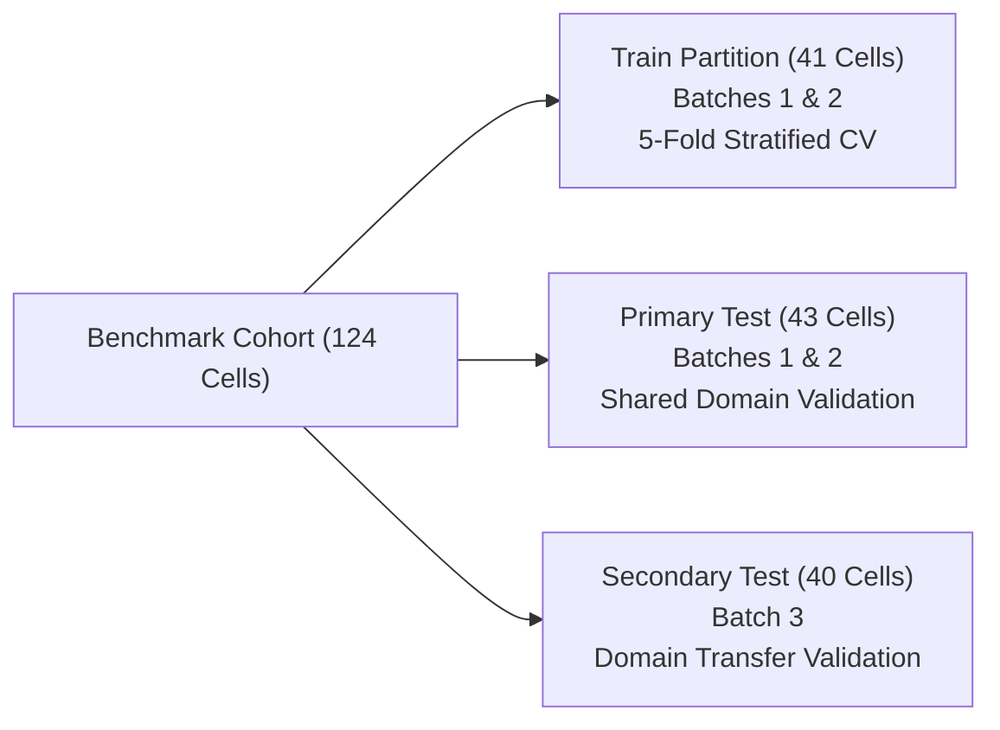

# Validation & Data Leakage Prevention Protocol

**Project Title:** Confidence-Aware Peer-Relative Degradation Trajectory Analysis for Early End-of-Life Risk Prediction in Lithium-Ion Batteries  
**Document:** Formal Anti-Leakage Rules, Cross-Validation Partitions, and Threshold Determination  
**Execution Date:** 2026-10-22  

---

## 1. Non-Negotiable Anti-Leakage Rules

To prevent artificial inflation of prognostics performance and guarantee reproducible generalization, this codebase enforces 8 rigorous anti-leakage invariants:

| Rule ID | Invariant Requirement | Implementation & Enforcement |
| :---: | :--- | :--- |
| **Rule 1** | **Battery-Level Split Disjointness** | Splits are assigned at the cell level. All cycle measurements of a given cell across all cutoffs ($N \in \{40, 70, 100\}$) strictly reside in the same split. Zero identity overlap between train, primary test, and secondary test. |
| **Rule 2** | **Temporal Causality** | Features at cutoff $N_{\text{obs}}$ utilize only cycle measurements $n \le N_{\text{obs}}$. Regression tests confirm that perturbing post-cutoff cycles produces zero change in extracted features. |
| **Rule 3** | **Training-Only Preprocessing** | Standardization scalers (`StandardScaler`) are fit exclusively on the training partition. Mean and standard deviation statistics from test data are never computed or leaked. |
| **Rule 4** | **Training-Only Probability Calibration** | Platt scaling calibrators (`ProbabilityCalibrator`) are fit strictly on 5-fold Stratified CV out-of-fold predictions within the training set. Final test labels are never accessed during calibration fitting. |
| **Rule 5** | **Training-Only Decision Thresholds** | Classification thresholds $\tau_{\text{opt}}$ maximizing Youden's $J = \text{Sensitivity} + \text{Specificity} - 1$ are derived strictly from training out-of-fold predictions. Test labels are never used to optimize operating cutoffs. |
| **Rule 6** | **Reference Peer Isolation** | Primary and secondary test cells are permitted to select reference peers **exclusively** from the training pool. A cell is strictly forbidden from matching itself ($i \notin \text{Peers}(i)$). |
| **Rule 7** | **Target Keyword Sequestration** | Feature vectors passed to machine learning pipelines undergo an automated keyword audit. Any column containing `eol`, `rul`, `life`, `target`, `status`, or `fail` triggers an immediate runtime exception. |
| **Rule 8** | **Covariate-Only Matching** | Peer selection distances are calculated strictly using initial operating covariates ($C_1, \text{SOC}, C_2, Q_{\text{initial}}$). Future trajectories, target outcomes, or test labels are strictly excluded from the reference matching process. |

---

## 2. Experimental Benchmark Partitions

The 124 benchmark-eligible cells are partitioned into three disjoint cohorts:

1. **Training Partition ($N = 41$ cells, 123 cutoff observations):**
   - Batches 1 and 2. Used exclusively for pipeline fitting, hyperparameter tuning, calibrator fitting, and threshold selection via 5-fold Stratified Cross-Validation.
2. **Primary Test Partition ($N = 43$ cells, 129 cutoff observations):**
   - Batches 1 and 2. Shared experimental batch domain with the training cohort. Evaluates in-domain prognostics performance and peer-relative generalization.
3. **Secondary Test Partition ($N = 40$ cells, 120 cutoff observations):**
   - Batch 3. Evaluates external domain transfer and cross-batch generalization where testing protocols and ambient temperatures varied slightly from Batches 1 & 2.

---

## 3. Automated Leakage Audit Test Results

The automated leakage audit (`src/models/leakage_audit.py` and `tests/test_no_leakage.py`, `tests/test_model_no_leakage.py`, `tests/test_peer_no_leakage.py`) runs 17 automated checks:
- Overlapping cell identities across partitions: **0 overlaps detected**.
- Target keywords in feature columns: **0 target keywords detected**.
- Post-cutoff measurement sensitivity: **Zero delta observed across all 34 features**.
- Standard scaler parameter divergence: **100% matched training means and standard deviations**.
- Peer selection pool violation: **100% of test cells selected peers strictly from training pool**.
- Self-matching occurrences: **Zero occurrences across all 372 benchmark instances**.
